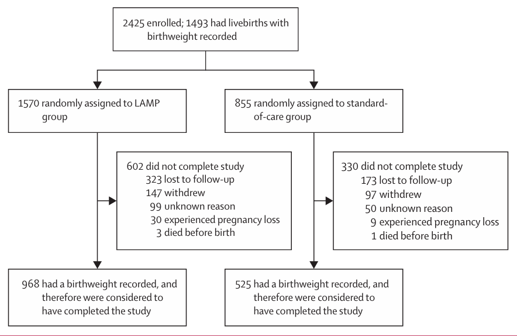
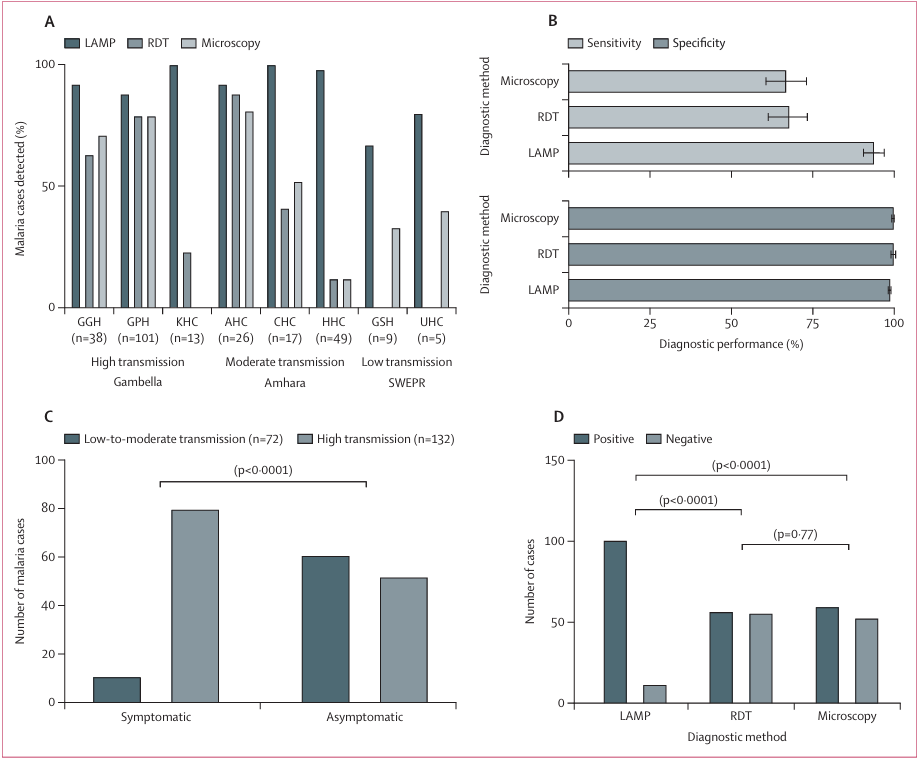
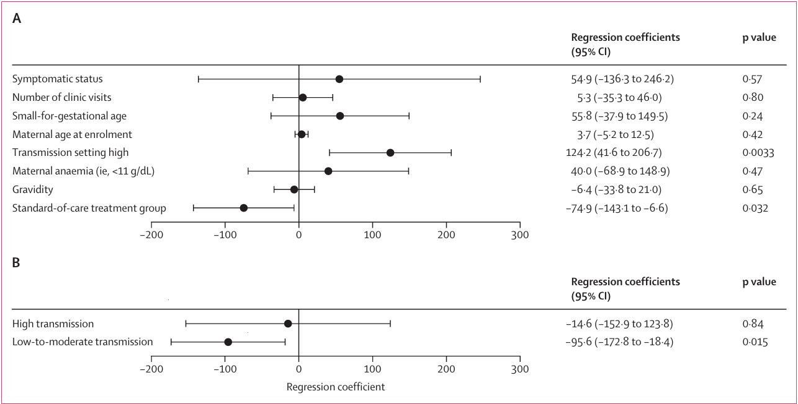

# 🦟 LAMPREG: Active Case Detection of Malaria in Pregnancy
[](#)
[](https://clinicaltrials.gov/ct2/show/NCT03754322)
[](https://creativecommons.org/licenses/by-nc-nd/4.0/)
[](#)

 📖 Project Overview
LAMPREG is a pragmatic randomised diagnostic outcomes trial conducted across eight health facilities in rural Ethiopia. The study evaluates the effectiveness of a screen-and-treat strategy using Loop-Mediated Isothermal Amplification (LAMP) technology compared to the standard of care (microscopy and RDT) for detecting and treating malaria in pregnancy (MiP). 
While LAMP demonstrated significantly higher sensitivity for detecting low-level and asymptomatic infections, the trial found no significant difference in the primary outcome of low birthweight. However, post-hoc analyses suggested potential benefits in infant weight gain by day 28.

 📂 Repository Structure
```text
LAMPREG_Project/
│
├── 📁 Published_Papers/
│   ├── 📄 LAMPREG_interim_results_presentation.pdf
│   └── 📄 Active-case-detection-using-loop-mediated-isotherm.pdf
│
├── 📁 Other_Documents/
│   ├── 📄 2022-09-19_data_clean_up_log.pdf
│   ├── 📄 Data_correction_workflow_v1.0_2022-09-19.pdf
│   ├── 📄 REDCap_Data_Dictionary_Codebook.pdf
│   ├── 📄 LAMPREG_list_of_variables_for_query_generation.pdf
│   └── 📄 outcomes_metric_with_Symptom.pdf
│
├── 📁 Analysis/
│   ├── 📊 analysis_PG_MG.smcl
│   ├── 📊 analysis_final_status.smcl
│   ├── 📊 outcome_metrics_analysis_final_status_JU.smcl
│   ├── 📊 outcome_metrics_analysis_gravida_JU.smcl
│   ├── 📊 outcome_metrics_analysis_malaria_symptom_JU.smcl
│   └── 📊 outcome_metrics_analysis_placenta_JU.smcl
│
├── 📁 Charts/
│   ├── 🖼️ Fig_1_CONSORT_Diagram.png
│   ├── 🖼️ Fig_2_Diagnostic_Performance.png
│   ├── 🖼️ Fig_3_Infant_Weight_Gain.png
│   ├── 🖼️ Fig_4_Outcomes_Table.png
│   └── 🖼️ Fig_5_Baseline_Characteristics.png
│
└── 📝 README.md
```


 📊 Key Visualizations & Results
# 1. Trial Profile (CONSORT Diagram)
Participant flow from enrollment through to per-protocol analysis.


<!-- Replace with actual CONSORT diagram from the paper -->

# 2. Diagnostic Performance
LAMP sensitivity and specificity compared to microscopy and RDT across transmission settings.


<!-- Replace with Figure 2 from the paper -->

# 3. Infant Weight Gain Analysis
Multivariable linear regression of the change score in infant weight gain.


<!-- Replace with Figure 3 from the paper -->

 🛠️ Data Management & Analysis Workflow
This repository adheres to strict data governance and reproducible research standards.
# Data Collection & Cleaning
- [x] REDCap Integration: Electronic Case Report Forms (eCRFs) built and managed in REDCap.
- [x] Data Dictionary: Comprehensive codebook for all clinical and lab variables.
- [x] Validation Rules: Automated queries for out-of-range or unexpected data (e.g., vital signs, hemoglobin limits).
- [x] Audit Trail: Full data cleaning log (`Data_Cleaning_Log.pdf`) tracking all database corrections.

# Statistical Analysis (Stata)
- [x] Baseline Characteristics: Generated for the intention-to-treat (ITT) population.
- [x] Primary & Secondary Outcomes: Evaluated using Welch's t-tests, Chi-square, and Fisher's exact tests.
- [x] Subgroup Analyses: Stratified by gravidity (primigravida vs. multigravida), symptom status, and transmission setting.
- [x] Regression Models: Adjusted low-birthweight frequencies (accounting for digit heaping) and infant weight-gain models.


# Prerequisites
To replicate the statistical analysis, you will need:
   Stata (Version 16 or higher recommended)
   REDCap access (for raw data extraction)


 👥 Authors & Affiliations
Principal Investigators: 
   Prof. Dylan R. Pillai (University of Calgary)
   Prof. Delenasaw Yewhalaw (Jimma University)
   Dr. Mekonnen Teferi (Armauer Hansen Research Institute)
   
Data Management: 
   Mr. Deneke Zewdu (TIDRC, Jimma University)

Institutions Involved:
   University of Calgary (Canada)
   Armauer Hansen Research Institute (Ethiopia)
   Jimma University (Ethiopia)
   Amhara Public Health Institute (Ethiopia)

 📜 License & Data Sharing
The publication is licensed under CC BY-NC-ND 4.0. 
We will make de-identified participant data available upon reasonable request, subject to a formal data sharing agreement (DSA) approved by both the University of Calgary and AHRI investigators.

 📚 Citation
If you use the data or code from this repository, please cite the primary publication:
> Fetr M, Tekgne B, Kamalidin C, et al. Active case detection using loop-mediated isothermal amplification technology and treatment versus standard of care for malaria in pregnancy in Ethiopia (LAMPREG): a pragmatic randomised diagnostic outcomes trial. Lancet Prim Care 2025; 1:100008.
